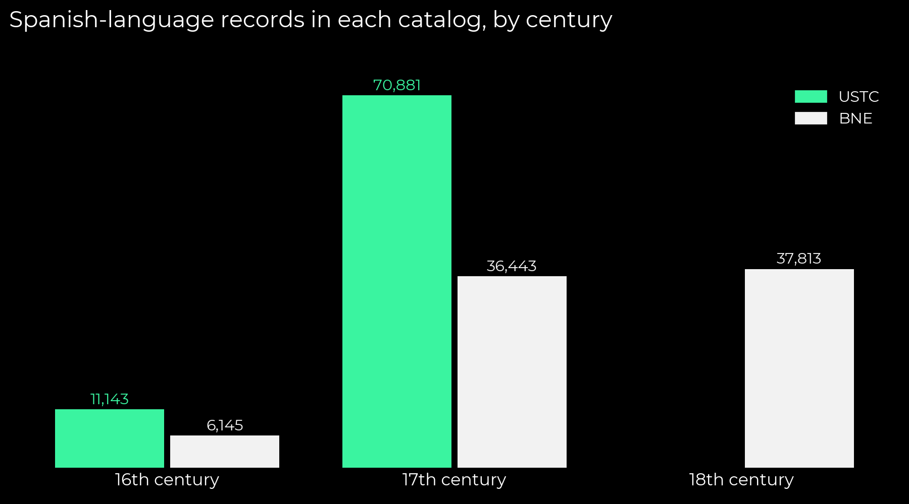
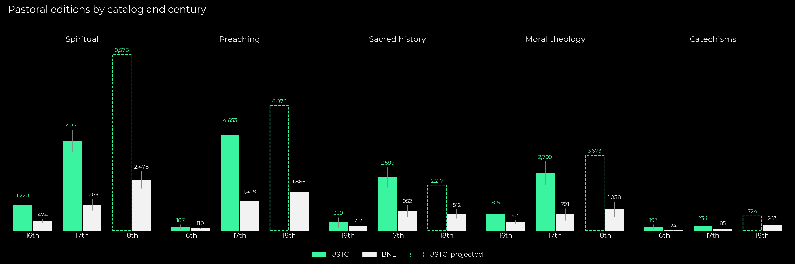
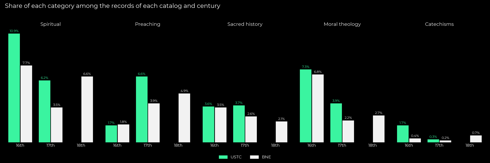
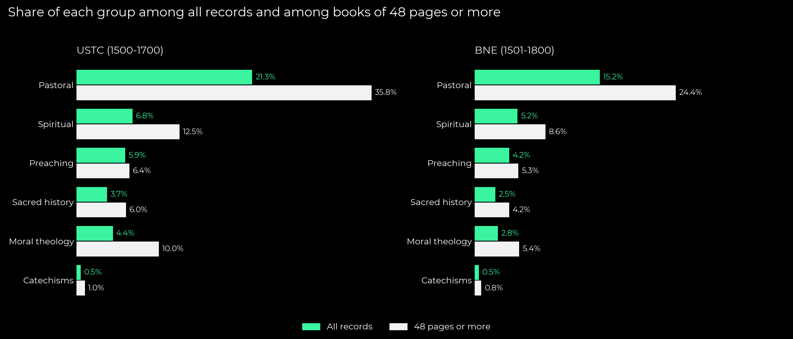
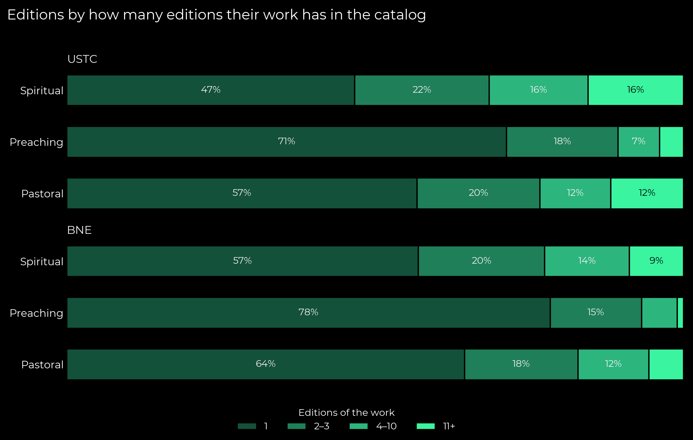

# How many spiritual and pastoral books were printed in Spanish, 1500–1800?

[English](#english) · [Español](#español) · [The code in brief / El código, en breve](#the-code-in-brief--el-código-en-breve)

## English

I estimate how many pastoral books, and within them how many spiritual books and how many works of preaching, were printed in
Spanish, from two library catalogs: the Universal Short Title Catalogue (USTC) and the catalog of the Biblioteca Nacional de
España (BNE). I classify a sample of titles with an open-weights language model and scale the result to each catalog, century by
century. I never add the two catalogs up, because many editions are in both.

**In short.** In the USTC (1500–1700), about 17,500 records (21 percent) are pastoral books in a broad sense: spiritual books,
preaching, sacred history, moral theology and catechisms. In the BNE (1501–1800) there are about 12,200 (15 percent). Spiritual
books (prayer, meditation, devotion, asceticism, mysticism) are the largest pastoral group in both catalogs: 6.8 percent of the
USTC and 5.2 percent of the BNE, ahead of preaching (5.9 and 4.2 percent). Among books of 48 pages or more, the spiritual share
almost doubles (12.5 and 8.6 percent), while preaching barely moves. Neither group was a handful of bestsellers: in both catalogs
about half or more of the spiritual editions belong to works printed only once.

### Data



| Catalog | Coverage | Records |
|---|---|---|
| USTC | Spanish-language editions, 1500–1700 (the USTC lists none after 1700) | 82,768 (744 without a year) |
| BNE, "monografías antiguas" | Spanish-language records, 1501–1800 | 80,401 |

The two catalogs overlap: in notebook 4 I link them by year and title, and about half of the BNE records for 1501–1700 (22,661
of 42,588) match a USTC edition. That is why every figure below is for one catalog and one century. Both catalogs describe
editions, not copies: the USTC lists the copies of an edition inside one record, and the BNE hangs its copies under one
bibliographic record. Some editions still appear twice in the BNE (issues, variants, volumes printed in different years): 2.7
percent of its records share title, year, printer and extent with another one. I downloaded the BNE files by hand from
datosabiertos.bne.es, whose server refuses scripted downloads. The data files stay outside the repository.

### Method

1. **Keyword lexicon** (notebook 3, `lexicon.py`). I normalize titles for early modern spelling ("christiana" → "cristiana",
   "deuocion" → "devocion") and search them for terms such as "meditaciones", "ejercicios espirituales", "novena", "sermón",
   "vida de san", "casos de conciencia" or "catecismo". A short list of spiritual authors (Luis de Granada, Thomas à Kempis,
   Teresa of Ávila, Juan de Ávila, Luis de la Puente, Juan Eusebio Nieremberg…) marks titles that say nothing ("Las obras").
   With the lexicon I sort every record into three piles: looks spiritual, looks otherwise pastoral, unmarked. The lexicon does
   not decide anything; it only organizes the draw.
2. **Stratified sample** (notebook 6). I draw 5,000 records at random: 1,250 from the spiritual pile, 1,250 from the other
   pastoral pile and 2,500 from the unmarked one, so that the small piles are well represented. The BNE sixteenth century had
   only 193 records in that sample, so I drew 807 more from it.
3. **Open language model** (notebooks 7 and 7b). Qwen3 8B (Apache 2.0), run with Ollama on a free Google Colab GPU, reads the
   title and author of each sampled record and chooses one of ten categories (`data/labeling_criteria.md`): spiritual,
   preaching, sacred history, moral theology, catechism, theology, Bible, liturgy, church government, not religious. The weights
   of an open model are public, so anyone can repeat my classification. I measured its accuracy on 200 titles I had labeled by
   hand in my Jesuit missionary-libraries project (see Limits).
4. **From the sample to the catalog** (notebook 8). I split each catalog into cells by century and lexicon pile. In each cell I
   take the share of the sample that the model put in a category and multiply it by the number of records in the cell; then I
   add up the cells of one catalog and century. The 95 percent interval depends on how many records I sampled in each cell.
5. **A check with a classifier** (notebook 7c). I trained a simple classifier (TF-IDF on pieces of two to five letters and a
   logistic regression) on the model's answers and let it label all 163,169 records. It agrees with the model on 77.7 percent
   of the sample. Corrected with the sample, it gives estimates close to the ones from the sample alone, with intervals that are
   not narrower, so the published figures come from the sample alone.

### Results

**1. Pastoral editions by catalog and century** (notebook 8, `results/estimates_by_century.csv`, with the 95 percent intervals)



| Group | USTC 16th | USTC 17th | BNE 16th | BNE 17th | BNE 18th | USTC 18th, projected |
|---|---|---|---|---|---|---|
| Pastoral | 2,814 | 14,656 | 1,241 | 4,520 | 6,458 | 20,940 |
| Spiritual | 1,220 | 4,371 | 474 | 1,263 | 2,478 | 8,576 |
| Preaching | 187 | 4,653 | 110 | 1,429 | 1,866 | 6,076 |
| Sacred history | 399 | 2,599 | 212 | 952 | 812 | 2,217 |
| Moral theology | 815 | 2,799 | 421 | 791 | 1,038 | 3,673 |
| Catechisms | 193 | 234 | 24 | 85 | 263 | 724 |

The USTC stops in 1700. For its eighteenth century I multiply the BNE figure for 1701–1800 by the USTC/BNE ratio of the
seventeenth century (`results/ustc_18th_projection.csv`). It is a rough projection: the ratio is not stable from one century
to the next (for spiritual books, 2.6 in the sixteenth century and 3.5 in the seventeenth; for preaching, 1.7 and 3.3).

**2. Shares by century** (`results/estimates_by_century.csv`). As a percent of the records of each catalog and century,
spiritual books fall from the sixteenth to the seventeenth century in both catalogs (USTC 10.9 → 6.2 percent; BNE 7.7 → 3.5)
and recover in the BNE eighteenth century (6.6). Preaching grows from under 2 percent in the sixteenth century to 4–7 percent
later.



**3. Books of 48 pages or more** (`results/estimates_by_length.csv`). Short print (single sermons, edicts, briefs) weighs less
there, and the pastoral share grows.



| Group | USTC, all | USTC, 48+ pages | BNE, all | BNE, 48+ pages |
|---|---|---|---|---|
| Pastoral | 21.3% | 35.8% | 15.2% | 24.4% |
| Spiritual | 6.8% | 12.5% | 5.2% | 8.6% |
| Preaching | 5.9% | 6.4% | 4.2% | 5.3% |
| Sacred history | 3.7% | 6.0% | 2.5% | 4.2% |
| Moral theology | 4.4% | 10.0% | 2.8% | 5.4% |
| Catechisms | 0.5% | 1.0% | 0.5% | 0.8% |

The rest of the records (`results/categories_by_column.csv`) are not religious (USTC 47 percent, BNE 59), church government and
legal print (28 and 23), liturgy (3 and 3) and a few Bibles.

**4. Reprints** (notebook 5, `results/unique_works.csv`, `results/work_concentration.csv`, `results/editions_by_reprints.csv`).
I call a work a group of editions with the same author's surname and the same opening words of the title. Here the classes come
from the lexicon, the only classification that covers every record (its preaching class is broader than the model's).



| | USTC spiritual | USTC preaching | BNE spiritual | BNE preaching |
|---|---|---|---|---|
| Editions (lexicon) | 5,622 | 6,189 | 4,809 | 4,716 |
| Distinct works | 3,100–3,400 | 4,600–5,000 | 3,100–3,300 | 3,900–4,100 |
| Editions per work | 1.67 | 1.24 | 1.45 | 1.16 |
| Share of the 10 most printed works | 6.8% | 3.5% | 4.8% | 2.1% |
| Share of the 10 most printed authors | 17.8% | 8.7% | 12.7% | 6.0% |
| Editions of works printed once | 46.7% | 71.3% | 57.0% | 78.4% |
| Editions of works printed three times or fewer | 68.5% | 89.4% | 77.5% | 93.2% |

My rule splits some works whose titles vary between editions, so the real concentration is somewhat higher; grouping by author
gives an upper bound, and even so the ten most printed spiritual authors (Granada, Nieremberg, Puente, Guevara, Osuna, Teresa of
Ávila…) account for less than a fifth of spiritual editions.

**5. Jesuit authors** (`results/jesuits.csv`). Among editions with a personal author, Jesuits wrote 16.0 percent of spiritual
editions in both catalogs, 13.7 (USTC) and 9.6 percent (BNE) of preaching editions, and 14.6 and 13.1 percent of pastoral ones. I
identify Jesuits with a list built from Wikidata, the BNE authority file and the inventories of Jesuit mission libraries
(notebook 2).

### Limits

- **The model misses spiritual books.** In my pilot, 97 percent of the books the model called spiritual were spiritual, but it
  found only 72 percent of them; for pastoral books, precision was 0.93 and recall 0.89. I therefore read the spiritual counts as
  lower bounds; dividing by the recall (multiplying by about 1.4) gives a rough upper bound, since the pilot titles are mostly
  well-known Jesuit works. I did not measure preaching apart. The keyword lexicon alone did worse (spiritual precision 0.76,
  recall 0.68).
- **Two categories are unreliable.** The model never chose "theology", and "church government" also took legal and
  administrative print that is not religious (lawsuits, royal finance, petitions), at the expense of "not religious."
  Neither affects the pastoral counts much.
- **Small cells.** The USTC sixteenth century has 347 sampled records and wide intervals (spiritual: 943–1,497). The 744 USTC
  records without a year stay out of the figures.
- **A note on the author does not help.** When I added a short description of the author from Wikidata (occupation, religious
  order), the model became more cautious and spiritual recall fell to 0.64, so my final run uses title and author only.

### Notebooks

| Notebook | What I do in it |
|---|---|
| `1_ustc_download` | Download the USTC's Spanish-language editions by subject |
| `2_jesuit_authors` | Build the list of Jesuit authors |
| `3_catalog_lexicon` | Join the two catalogs in one table, add length and Jesuit authorship, apply the keyword lexicon |
| `4_link_ustc_bne` | Link USTC and BNE records of the same edition |
| `5_works` | Measure how concentrated editions are in a few works, catalog by catalog |
| `6_llm_sample` | Draw the stratified sample and the extra sample of the BNE sixteenth century |
| `7_llm_count` | Run the language model on the sample in Google Colab (T4 GPU, about one hour) |
| `7b_llm_count_bne16` | Run the same model on the extra sample (Google Colab, about ten minutes) |
| `7c_ml_classifier` | Train the check classifier on the model's answers |
| `8_report` | Estimates by catalog and century, the projection, tables, figures |

The notebooks run in order in Jupyter (Python 3.9, pandas, scikit-learn for notebooks 4 and 7c, matplotlib); notebooks 7 and 7b
run on Google Colab. `helpers.py` and `lexicon.py` hold the shared functions. Paths are set in the first cell of each notebook.

---

## Español

Estimo cuántos libros pastorales, y dentro de ellos cuántos libros espirituales y cuántas obras de predicación, se imprimieron
en castellano, a partir de dos catálogos: el Universal Short Title Catalogue (USTC) y el catálogo de la Biblioteca Nacional de
España (BNE). Clasifico una muestra de títulos con un modelo de lenguaje de pesos abiertos y llevo el resultado a cada catálogo,
siglo por siglo. Nunca sumo los dos catálogos, porque muchas ediciones están en ambos.

**En pocas palabras.** En el USTC (1500–1700), unos 17.500 registros (21 %) son libros pastorales en sentido amplio: libros
espirituales, predicación, historia sacra, teología moral y catecismos. En la BNE (1501–1800) hay unos 12.200 (15 %). Los libros
espirituales (oración, meditación, devoción, ascética, mística) forman el grupo pastoral más grande en los dos catálogos: el
6,8 % del USTC y el 5,2 % de la BNE, por delante de la predicación (5,9 y 4,2 %). Entre los libros de 48 páginas o más, lo
espiritual casi se duplica (12,5 y 8,6 %), mientras que la predicación apenas cambia. Ninguno de los dos grupos era un puñado de
éxitos reimpresos: en los dos catálogos, la mitad o más de las ediciones espirituales pertenecen a obras impresas una sola vez.

### Datos

| Catálogo | Cobertura | Registros |
|---|---|---|
| USTC | Ediciones en castellano, 1500–1700 (el USTC no registra ninguna después de 1700) | 82.768 (744 sin año) |
| BNE, "monografías antiguas" | Registros en castellano, 1501–1800 | 80.401 |

Los dos catálogos se superponen: en el notebook 4 los enlazo por año y título, y más o menos la mitad de los registros de la BNE
de 1501–1700 (22.661 de 42.588) coinciden con una edición del USTC. Por eso cada cifra de abajo es de un catálogo y un siglo.
Los dos catálogos describen ediciones, no ejemplares: el USTC enumera los ejemplares de una edición dentro de un registro, y la
BNE cuelga sus ejemplares de un registro bibliográfico. Aun así, algunas ediciones aparecen dos veces en la BNE (emisiones,
variantes, tomos impresos en años distintos): el 2,7 % de sus registros comparte título, año, impresor y extensión con otro. Los
archivos de la BNE los bajé a mano de datosabiertos.bne.es, porque su servidor rechaza las descargas automáticas. Los datos
quedan fuera del repositorio.

### Método

1. **Léxico de palabras clave** (notebook 3, `lexicon.py`). Unifico las grafías antiguas de los títulos ("christiana" →
   "cristiana", "deuocion" → "devocion") y busco términos como "meditaciones", "ejercicios espirituales", "novena", "sermón",
   "vida de san", "casos de conciencia" o "catecismo". Una lista breve de autores espirituales (Luis de Granada, Tomás de Kempis,
   Teresa de Jesús, Juan de Ávila, Luis de la Puente, Juan Eusebio Nieremberg…) marca los títulos que no dicen nada ("Las obras").
   Con el léxico separo cada registro en tres montones: parece espiritual, parece otro pastoral, sin marca. El léxico no decide
   nada; solo ordena el sorteo.
2. **Muestra estratificada** (notebook 6). Sorteo 5.000 registros: 1.250 del montón espiritual, 1.250 del otro pastoral y 2.500
   del montón sin marca, para que los montones chicos queden bien representados. La BNE del siglo XVI tenía solo 193 registros
   en esa muestra, así que sorteé 807 más de ella.
3. **Modelo de lenguaje abierto** (notebooks 7 y 7b). Qwen3 8B (Apache 2.0), que corrí con Ollama en una GPU gratuita de Google
   Colab, lee el título y el autor de cada registro de la muestra y elige una de diez categorías (`data/labeling_criteria.md`):
   espiritual, predicación, historia sacra, teología moral, catecismo, teología, Biblia, liturgia, gobierno eclesiástico, no
   religioso. Los pesos de un modelo abierto son públicos, así que cualquiera puede repetir mi clasificación. Medí su precisión
   con 200 títulos que había etiquetado a mano en mi proyecto de bibliotecas misionales jesuitas (ver Límites).
4. **De la muestra al catálogo** (notebook 8). Divido cada catálogo en casillas por siglo y por montón del léxico. En cada casilla
   tomo la proporción de la muestra que el modelo puso en una categoría y la multiplico por la cantidad de registros de la
   casilla; después sumo las casillas de un catálogo y un siglo. El intervalo de 95 % depende de cuántos registros sorteé en
   cada casilla.
5. **Un control con un clasificador** (notebook 7c). Entrené un clasificador simple (TF-IDF sobre trozos de dos a cinco letras y
   una regresión logística) con las respuestas del modelo y con él etiqueté los 163.169 registros. Coincide con el modelo en el
   77,7 % de la muestra. Corregido con la muestra, da estimaciones parecidas a las de la muestra sola, con intervalos que no son
   más estrechos, así que las cifras publicadas salen solo de la muestra.

### Resultados

**1. Ediciones pastorales por catálogo y siglo** (notebook 8, `results/estimates_by_century.csv`, con los intervalos de 95 %)

| Grupo | USTC XVI | USTC XVII | BNE XVI | BNE XVII | BNE XVIII | USTC XVIII, proyección |
|---|---|---|---|---|---|---|
| Pastoral | 2.814 | 14.656 | 1.241 | 4.520 | 6.458 | 20.940 |
| Espiritual | 1.220 | 4.371 | 474 | 1.263 | 2.478 | 8.576 |
| Predicación | 187 | 4.653 | 110 | 1.429 | 1.866 | 6.076 |
| Historia sacra | 399 | 2.599 | 212 | 952 | 812 | 2.217 |
| Teología moral | 815 | 2.799 | 421 | 791 | 1.038 | 3.673 |
| Catecismos | 193 | 234 | 24 | 85 | 263 | 724 |

El USTC termina en 1700. Para su siglo XVIII multiplico la cifra de la BNE de 1701–1800 por la proporción USTC/BNE del siglo
XVII (`results/ustc_18th_projection.csv`). Es una proyección gruesa: la proporción no es estable de un siglo a otro (en los
libros espirituales, 2,6 en el siglo XVI y 3,5 en el XVII; en la predicación, 1,7 y 3,3).

**2. Porcentajes por siglo** (`results/estimates_by_century.csv`). Como porcentaje de los registros de cada catálogo y siglo, lo
espiritual baja del siglo XVI al XVII en los dos catálogos (USTC 10,9 → 6,2 %; BNE 7,7 → 3,5) y se recupera en la BNE del siglo
XVIII (6,6). La predicación pasa de menos del 2 % en el siglo XVI al 4–7 % después.

**3. Libros de 48 páginas o más** (`results/estimates_by_length.csv`). Ahí pesan menos los impresos breves (sermones sueltos,
edictos, alegatos) y crece la parte pastoral.

| Grupo | USTC, todos | USTC, 48+ páginas | BNE, todos | BNE, 48+ páginas |
|---|---|---|---|---|
| Pastoral | 21,3 % | 35,8 % | 15,2 % | 24,4 % |
| Espiritual | 6,8 % | 12,5 % | 5,2 % | 8,6 % |
| Predicación | 5,9 % | 6,4 % | 4,2 % | 5,3 % |
| Historia sacra | 3,7 % | 6,0 % | 2,5 % | 4,2 % |
| Teología moral | 4,4 % | 10,0 % | 2,8 % | 5,4 % |
| Catecismos | 0,5 % | 1,0 % | 0,5 % | 0,8 % |

El resto de los registros (`results/categories_by_column.csv`) son no religiosos (USTC 47 %, BNE 59), gobierno eclesiástico e
impresos jurídicos (28 y 23), liturgia (3 y 3) y unas pocas Biblias.

**4. Reediciones** (notebook 5, `results/unique_works.csv`, `results/work_concentration.csv`, `results/editions_by_reprints.csv`).
Llamo obra a un grupo de ediciones con el mismo apellido de autor y las mismas primeras palabras del título. Acá las clases salen
del léxico, la única clasificación que cubre todos los registros (su clase de predicación es más amplia que la del modelo).

| | USTC espiritual | USTC predicación | BNE espiritual | BNE predicación |
|---|---|---|---|---|
| Ediciones (léxico) | 5.622 | 6.189 | 4.809 | 4.716 |
| Obras distintas | 3.100–3.400 | 4.600–5.000 | 3.100–3.300 | 3.900–4.100 |
| Ediciones por obra | 1,67 | 1,24 | 1,45 | 1,16 |
| Peso de las 10 obras más impresas | 6,8 % | 3,5 % | 4,8 % | 2,1 % |
| Peso de los 10 autores más impresos | 17,8 % | 8,7 % | 12,7 % | 6,0 % |
| Ediciones de obras impresas una sola vez | 46,7 % | 71,3 % | 57,0 % | 78,4 % |
| Ediciones de obras impresas tres veces o menos | 68,5 % | 89,4 % | 77,5 % | 93,2 % |

Mi regla separa algunas obras cuyos títulos cambian de una edición a otra, así que la concentración real es algo mayor; agrupar
por autor da una cota superior, y aun así los diez autores espirituales más impresos (Granada, Nieremberg, Puente, Guevara,
Osuna, Teresa de Jesús…) no llegan a la quinta parte de las ediciones espirituales.

**5. Autores jesuitas** (`results/jesuits.csv`). Entre las ediciones con autor personal, los jesuitas escribieron el 16,0 % de
las espirituales en los dos catálogos, el 13,7 (USTC) y el 9,6 % (BNE) de las de predicación, y el 14,6 y el 13,1 % de las
pastorales. Identifico a los jesuitas con una lista que armé a partir de Wikidata, el archivo de autoridades de la BNE y los
inventarios de las bibliotecas de las misiones jesuitas (notebook 2).

### Límites

- **El modelo pierde libros espirituales.** En mi piloto, el 97 % de los libros que el modelo llamó espirituales lo eran, pero
  encontró solo el 72 % de ellos; en los pastorales, la precisión fue 0,93 y el recall 0,89. Por eso tomo los conteos de
  espirituales como pisos; si los divido por el recall (los multiplico por 1,4, más o menos) obtengo un techo aproximado, porque
  los títulos del piloto son sobre todo obras jesuitas conocidas. La predicación no la medí por separado. El léxico solo
  funcionó peor (precisión espiritual 0,76, recall 0,68).
- **Dos categorías no son confiables.** El modelo nunca eligió "teología", y "gobierno eclesiástico" se llevó además impresos
  jurídicos y administrativos que no son religiosos (pleitos, hacienda real, memoriales), en detrimento de "no religioso".
  Ninguna de las dos cosas mueve mucho los conteos pastorales.
- **Casillas chicas.** El USTC del siglo XVI tiene 347 registros sorteados e intervalos anchos (espiritual: 943–1.497). Los 744
  registros del USTC sin año quedan fuera de las cifras.
- **La nota sobre el autor no ayuda.** Cuando agregué una descripción breve del autor tomada de Wikidata (ocupación, orden
  religiosa), el modelo se volvió más cauto y el recall espiritual bajó a 0,64; por eso mi corrida final usa solo título y autor.

### Notebooks

| Notebook | Qué hago en él |
|---|---|
| `1_ustc_download` | Descargo las ediciones en castellano del USTC por materia |
| `2_jesuit_authors` | Armo la lista de autores jesuitas |
| `3_catalog_lexicon` | Junto los dos catálogos en una tabla, agrego extensión y autoría jesuita, aplico el léxico |
| `4_link_ustc_bne` | Enlazo los registros del USTC y la BNE de una misma edición |
| `5_works` | Mido cuánto se concentran las ediciones en pocas obras, catálogo por catálogo |
| `6_llm_sample` | Saco la muestra estratificada y la muestra extra de la BNE del siglo XVI |
| `7_llm_count` | Corro el modelo de lenguaje sobre la muestra en Google Colab (GPU T4, alrededor de una hora) |
| `7b_llm_count_bne16` | Corro el mismo modelo sobre la muestra extra (Google Colab, unos diez minutos) |
| `7c_ml_classifier` | Entreno el clasificador de control con las respuestas del modelo |
| `8_report` | Estimaciones por catálogo y siglo, la proyección, tablas, gráficos |

Los notebooks se corren en orden en Jupyter (Python 3.9, pandas, scikit-learn para los notebooks 4 y 7c, matplotlib); los
notebooks 7 y 7b se corren en Google Colab. `helpers.py` y `lexicon.py` guardan las funciones compartidas. Las rutas están en la
primera celda de cada notebook. Los gráficos están en inglés; sus datos, en las tablas de arriba.

---

## The code in brief / El código, en breve

Excerpts from the notebooks, not the full code. / Extractos de los notebooks, no el código completo.

**1. Join the two catalogs / Juntar los dos catálogos** (notebook 3). The same columns for both, one table.
Las mismas columnas para los dos, una sola tabla.

```python
ustc_table = ustc.assign(source="ustc", author_text=ustc["authorship"].fillna(""), volumes=1)
bne_table = bne.assign(source="bne", title=bne["titulo"], author_text=bne["autores"].fillna(""))
table = pd.concat([ustc_table[columns], bne_table[columns]], ignore_index=True)
```

**2. Sort every record into three piles / Separar cada registro en tres montones** (notebook 3).

```python
table["group"] = table["title"].map(lambda t: (sorted(match_groups(t)) or ["none"])[0])
table["lexicon_class"] = "other_pastoral"
table.loc[table["group"] == "none", "lexicon_class"] = "none"
table.loc[(table["group"] == "spiritual") | table["by_author"], "lexicon_class"] = "spiritual"
```

**3. Draw the sample / Sortear la muestra** (notebook 6). A fixed number of records from each pile.
Una cantidad fija de registros de cada montón.

```python
SAMPLE_SIZES = {"spiritual": 1250, "other_pastoral": 1250, "none": 2500}
for stratum, n in SAMPLE_SIZES.items():
    parts.append(catalog[catalog["lexicon_class"] == stratum].sample(n, random_state=SEED))
```

**4. Ask the model / Preguntarle al modelo** (notebooks 7 and 7b). The answer is forced to one of the ten categories.
La respuesta está forzada a una de las diez categorías.

```python
answer_format = {"type": "object",
                 "properties": {"category": {"type": "string", "enum": CATEGORIES}},
                 "required": ["category"]}
reply = requests.post("http://localhost:11434/api/chat", json={
    "model": "qwen3:8b", "messages": [...], "format": answer_format,
    "think": False, "stream": False, "options": {"temperature": 0}})
```

**5. From the sample to the catalog / De la muestra al catálogo** (notebook 8). In each cell, the share of the sample in the
group times the records of the cell. En cada casilla, la proporción de la muestra en el grupo por los registros de la casilla.

```python
def estimate(categories, source, centuries, condition="all"):
    total = 0
    variance = 0
    for century in centuries:
        for stratum in ["spiritual", "other_pastoral", "none"]:
            N = ((catalog["source"] == source) & (catalog["century"] == century) & (catalog["lexicon_class"] == stratum)).sum()
            rows = labeled[(labeled["source"] == source) & (labeled["century"] == century) & (labeled["lexicon_class"] == stratum)]
            p = (rows["llm_category"].isin(categories) & rows[condition]).mean()
            total = total + N * p
            variance = variance + N * N * p * (1 - p) / len(rows)
    return total, 1.96 * math.sqrt(variance)

estimate(["espiritual"], "bne", ["16th"])   # -> (474, 89): about 474 editions, ± 89
```

**6. Project the USTC eighteenth century / Proyectar el siglo XVIII del USTC** (notebook 8).

```python
ratio_17 = value["USTC", "17th"] / value["BNE", "17th"]
projected = value["BNE", "18th"] * ratio_17
```

**7. Group editions into works / Agrupar ediciones en obras** (notebook 5). Same surname, same first three words of the title.
Mismo apellido, mismas tres primeras palabras del título.

```python
catalog["work_key"] = catalog["author_key"] + " | " + catalog["title"].map(title_start)
editions_per_work = editions["work_key"].map(editions["work_key"].value_counts())
```
